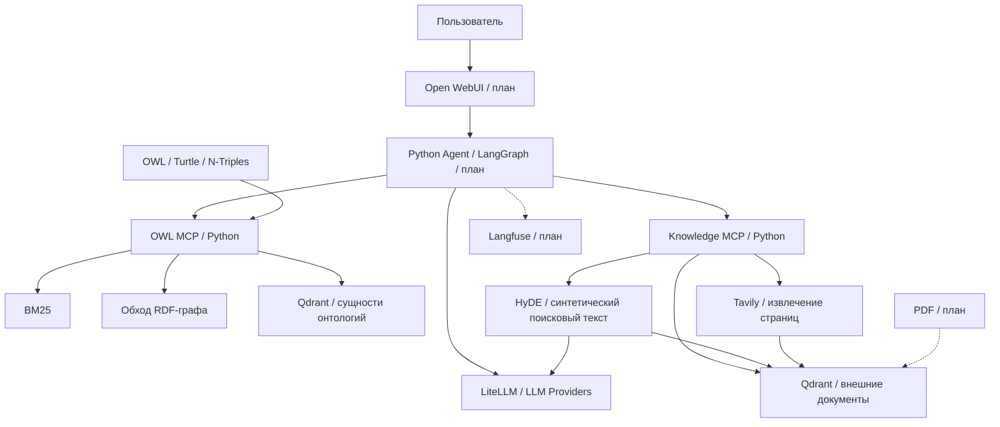

# OWL GraphRAG: Python, MCP и AI Agent

Система для вопросов на естественном языке к OWL-онтологиям и техническим
источникам. Онтология подтверждает структуру и связи, статьи и веб-страницы
помогают объяснить методы. Ответ должен ссылаться на фактически найденные данные.

Реализация написана на Python. Исходный код находится в `src/owl_rag/`.

## Состояние проекта

| Возможность | Статус |
| --- | --- |
| RDF/XML, Turtle, N-Triples через RDFLib | Реализовано |
| Несколько онтологий, явный `ontology_id`, SHA-256 файла | Реализовано; файлы выбираются при запуске |
| Именованные классы, родители/дети, входящие/исходящие тройки | Реализовано |
| BM25, поиск по IRI, именам, меткам и описаниям | Реализовано |
| Qdrant + embeddings, объединение с BM25 через RRF | Реализовано; нужен настроенный encoder |
| Обход графа с ограничениями и сохранением анонимных выражений | Реализовано |
| OWL MCP, stdio и Streamable HTTP | Реализовано |
| Knowledge MCP: vector search, HyDE, web-search → индексация | Реализовано; внешние вызовы требуют настройки провайдеров |
| Загрузка PDF и ссылки на страницы | Следующая итерация |
| LiteLLM, Qdrant и оба MCP-сервера в Compose | Реализовано; настройки из локального `.env` |
| ReAct-агент и API для Open WebUI | Следующая итерация |
| Langfuse, набор оценочных вопросов, демонстрация | Завершающая итерация |
| Reasoner, проверка непротиворечивости, полноценный OWL 2 DL | Вне текущего MVP |

Это первая рабочая итерация Python-версии, а не готовый пользовательский чат.

## Быстрый старт

Нужны Python 3.11+ и [uv](https://docs.astral.sh/uv/).
Команды выполняются из корня репозитория.

```bash
uv sync --locked
uv run owl-inspect examples/ontologies/minimal.owl
uv run owl-inspect examples/ontologies/minimal.owl --entity Hardware
uv run owl-inspect examples/ontologies/search.owl --query "vector database"
uv run owl-inspect examples/ontologies/minimal.owl --query Computer --context --depth 2
uv run pytest -q
uv run ruff check src tests
```

Для проверок перед коммитом установите Git-хук:

```bash
uv run pre-commit install
uv run pre-commit run --all-files
```

Включены поиск секретов и приватных ключей, блокировка локальных `.env`,
Ruff, MyPy, Bandit и Hadolint. Подробнее — [проверки разработки](docs/development.md).

CLI выдаёт JSON. Для своей онтологии замените путь; `.owl` по умолчанию означает
RDF/XML. Если файл содержит Turtle, укажите `--format turtle`.

Запуск OWL MCP без LLM и Qdrant, для клиента со stdio:

```bash
uv run owl-mcp --ontology demo=examples/ontologies/minimal.owl
```

Для HTTP и нескольких онтологий:

```bash
uv run owl-mcp --transport streamable-http --port 8001 \
  --ontology demo=examples/ontologies/minimal.owl \
  --ontology ai=examples/ontologies/search.owl
```

Адрес: `http://127.0.0.1:8001/mcp`. Сервер ожидает MCP-клиента;
открытие этого адреса браузером не является проверкой инструментов.

## Стек

| Область | Библиотека / сервис | Причина выбора |
| --- | --- | --- |
| RDF / OWL | [RDFLib](https://rdflib.readthedocs.io/en/latest/) | RDF-граф, распространённые синтаксисы, URIRef / BNode / Literal |
| MCP | [Официальный Python SDK, ветка 1.x](https://github.com/modelcontextprotocol/python-sdk/tree/v1.x) | Типизированные инструменты, stdio и Streamable HTTP; версия закреплена lock-файлом |
| Текстовый поиск | [rank-bm25](https://github.com/dorianbrown/rank_bm25) | Прозрачный BM25 для небольших онтологий |
| Векторная база | [Qdrant](https://qdrant.tech/documentation/) и `qdrant-client` | Хранение, cosine search, фильтры источников и версий |
| Embeddings | LiteLLM HTTP adapter или [Sentence Transformers](https://sbert.net/) | Заменяемый encoder; локальная модель — необязательная зависимость |
| HyDE | LLM через LiteLLM + Qdrant | Гипотетический текст используется только как поисковый запрос |
| Web-search | [Tavily Search API](https://docs.tavily.com/documentation/api-reference/endpoint/search) через HTTPX | Поисковые результаты и извлечённый текст страниц |
| Агент | [LangGraph](https://docs.langchain.com/oss/python/langgraph/overview), запланирован | Управляемый цикл вызовов инструментов с пределом шагов |
| API / UI | FastAPI и Open WebUI, запланированы | HTTP-интерфейс общения с агентом |
| PDF | [pypdf](https://pypdf.readthedocs.io/), запланирован | Текст по страницам и проверяемые ссылки; OCR отдельно |
| Проверки | pytest, Ruff | Поведение графа, поиск, Qdrant и протокол MCP |

`uv.lock` фиксирует зависимости. Тяжёлые модели и ключи не нужны для лексического
поиска и базовой навигации.

## Целевая архитектура



OWL MCP не зависит от агента, LangGraph и модели генерации. Его векторный поиск
подключается отдельно. Knowledge MCP содержит инструменты, которым нужны внешние
модели и web-search. Агент будет обращаться к обоим серверам по MCP.

### Что хранится в Qdrant

- `owl_entities_<model hash>`: текстовые представления именованных субъектов;
  фильтры `ontology_id`, `version`, `kinds`. Сам RDF-граф хранится в RDFLib.
- `knowledge_chunks_<model hash>`: фрагменты веб-страниц, позднее PDF;
  фильтры `workspace`, `source_type`, `document_id`.
- Каждая коллекция связана с идентификатором encoder; размерность проверяется.
  При смене модели или её версии нужен новый идентификатор и переиндексация.
- Веб-фрагменты сохраняют URL, заголовок, SHA-256 индексированного текста,
  дату извлечения, исходный поисковый запрос и индекс фрагмента.

`workspace` изолирует выборку документов, но не заменяет авторизацию.
Текущий Compose предназначен для локальной разработки и публикует порты на localhost.

## Qdrant, embeddings и инструменты исследования

Готовы [compose.yaml](compose.yaml), [.env.example](.env.example) и
[конфигурация LiteLLM](deploy/litellm/config.yaml). Дополни свой локальный `.env`
именами upstream-моделей, их ключами и ключом Tavily. Пошаговое описание:
[запуск Docker](docs/docker.md).

```bash
docker compose config --quiet
docker compose up -d --build
docker compose ps
```

Запускаются LiteLLM, Qdrant, OWL MCP и Knowledge MCP. Chat-модель доступна через
alias `chat`, embedding-модель — через `embeddings`. HyDE использует `chat`.
Агент и Open WebUI пока не реализованы и не входят в этот Compose.

LiteLLM API: `http://localhost:4000/v1`, OWL MCP: `http://localhost:8001/mcp`,
Knowledge MCP: `http://localhost:8002/mcp`. Внутри Docker адреса сервисов
подставляются автоматически. Ключи провайдеров получает LiteLLM; MCP-сервисы
получают только ключ прокси.

Для Python-команд на хосте `.env` загружается явно:

```bash
uv run --env-file .env owl-inspect examples/ontologies/search.owl \
  --query "semantic retrieval" --mode hybrid
```

Первое включение векторного индекса вызывает embedding API. Без
`TAVILY_API_KEY` Knowledge MCP запускается, но инструмент web-search возвращает
ошибку настройки. Генерация HyDE и поиск в интернете могут тарифицироваться
соответствующими провайдерами.

Локальный encoder подключается явно:

```bash
uv sync --locked --extra semantic
export EMBEDDING_BACKEND=sentence-transformers
export EMBEDDING_MODEL=sentence-transformers/paraphrase-multilingual-MiniLM-L12-v2
```

При первом использовании Sentence Transformers загружает модель. Выбор
embedding-модели нужно проверить на реальных русских и английских вопросах;
само наличие векторов не гарантирует качество поиска.

## Поток обработки запроса

1. Агент принимает вопрос и выбранную онтологию; агент пока в плане.
2. Через `search_entities` находит кандидатов: BM25 либо BM25 + Qdrant с RRF.
3. Через `retrieve_context` получает ограниченный фрагмент исходного графа;
   при необходимости уточняет сущность и её связи отдельными MCP-вызовами.
4. Для объяснений методов вызывает `search_knowledge`. При слабом совпадении
   может выбрать `hyde_search`: LLM генерирует гипотетический документ,
   encoder преобразует его в вектор, Qdrant возвращает реальные фрагменты.
5. Если источников в базе мало, вызывает `web_search_and_index`. Tavily ищет
   страницы, извлечённый текст делится на фрагменты и записывается в Qdrant;
   затем информация доступна последующим поисковым запросам.
6. Агент формирует ответ по найденным источникам с полными IRI / URL и
   версиями. Синтетический текст HyDE не может быть подтверждением ответа.

HyDE — поисковое расширение, а не проверка истинности. Метод описан в
[статье Gao et al.](https://aclanthology.org/2023.acl-long.99/).

Результат web-search не становится аксиомой OWL. Страницы остаются внешними
непроверенными источниками. Сниппеты и готовые ответы поискового провайдера
не сохраняются как полный текст страницы. При отсутствии извлечённого текста
документ пропускается с объяснением.

## Границы поддержки OWL

- Читаются **RDF/XML, Turtle, N-Triples**. OWL/XML, Manchester и Functional Syntax
  не поддерживаются. Расширение файла не определяет его синтаксис.
- Сохраняются RDF-тройки: IRI, анонимные узлы, литералы, типы и языки.
  RDFLib может нормализовать лексическую запись типизированного литерала;
  версия документа вычисляется по исходным байтам.
- `list_classes` показывает явные `rdf:type owl:Class`. Поиск также распознаёт
  явно объявленные `rdfs:Class`. Экземпляры в фильтре `individual` требуют
  явного `owl:NamedIndividual`; вывод типов пока не выполняется.
- Родители и дети — прямые именованные связи `rdfs:subClassOf`.
- Анонимные ограничения доступны как связанные исходные тройки; их наличие
  в выдаче не означает полный семантический разбор OWL-выражения.
- `owl:imports` сохраняется, импортируемые документы автоматически не скачиваются.
- Reasoner отсутствует. `A subClassOf B`, `B subClassOf C` не добавляют новую
  тройку `A subClassOf C`. Обход графа сохраняет исходные утверждения.
- Отсутствие факта не означает его ложность: учитывается открытый мир OWL.
  Полная поддержка OWL 2 DL / Full и профилей EL / QL / RL не заявляется.

Обход ограничен глубиной 0–4, количеством ресурсных узлов и троек; литералы
сохраняются в тройках, но не расширяются. Служебные узлы RDF/RDFS/OWL/XSD/SKOS
включаются как конечные, чтобы общий `owl:Class` не связывал все классы в контекст.
Достижение глубины означает заданную область обхода, а не полноту ответа.
При исчерпании бюджетов `truncated=true` и указана причина.
Метки анонимных узлов действуют только в текущей загрузке графа.

## Структура и чтение кода

```text
src/owl_rag/
  ontology.py          # загрузка и прямые операции RDF
  models.py            # JSON-термы и источники
  search.py            # BM25, точные совпадения, RRF
  vector_store.py      # Qdrant, векторы и фильтры
  context.py           # ограниченный BFS по RDF
  service.py           # операции над реестром онтологий
  mcp_server.py        # OWL MCP
  knowledge.py         # фрагменты документов, HyDE, пополнение базы
  web_search.py        # Tavily и URL источников
  providers.py         # HTTP-адаптеры LiteLLM
  knowledge_server.py  # Knowledge MCP
  config.py            # настройки через окружение
  cli.py               # локальная проверка без агента
```

См. [карту кода](docs/code-tour.md), [контракт MCP](docs/mcp-tools.md),
[поиск](docs/search.md), [план PDF-базы](docs/paper-library.md) и
[итерации разработки](docs/roadmap.md).

## Проверки и ограничения первой итерации

Тесты используют реальный RDFLib, Qdrant Client в локальном режиме и stdio MCP.
Модели и HTTP API заменены контролируемыми тестовыми адаптерами; платные API
без ключей не вызываются. Это проверяет интеграцию, а не качество реальных
embeddings, генерации HyDE или web-search.

Обновление URL идемпотентно по идентификаторам фрагментов. После успешной записи
удаляется хвост от более длинной прошлой версии. Обновление многих фрагментов
не является одной транзакцией; пока предполагается один пишущий Knowledge MCP.
Старые версии онтологий могут оставаться в Qdrant, но поиск фильтрует текущую
версию. Очистка старых индексов, auth, очередь загрузок и автоматическое
обновление веб-источников пока не реализованы.

`make demo`, `make test`, `make lint` — короткие варианты Python-команд.
