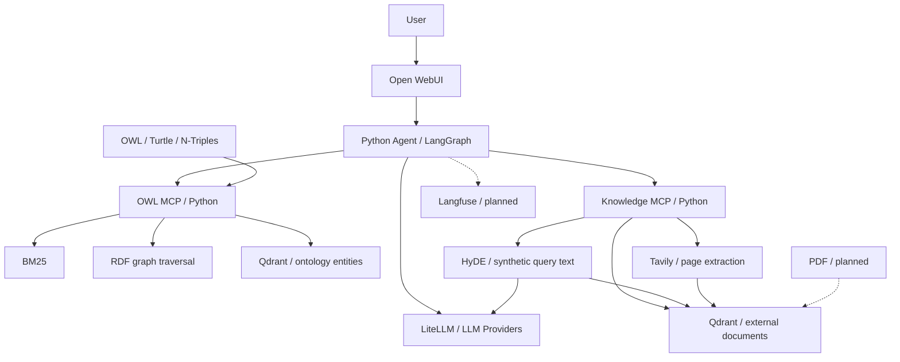

# OWL GraphRAG: Python, MCP and AI Agent

A system for answering natural-language questions about OWL ontologies and technical
sources. The ontology provides evidence for structure and relationships; papers and
web pages help explain methods. Answers should cite the data actually retrieved.

The implementation is written in Python. Source code lives in `src/owl_rag/`.

## Project status

| Capability | Status |
| --- | --- |
| RDF/XML, Turtle and N-Triples through RDFLib | Implemented |
| Multiple ontologies, explicit `ontology_id`, file SHA-256 | Implemented; files are selected at startup |
| Named classes, parents/children, incoming/outgoing triples | Implemented |
| BM25 and search by IRI, local name, labels and descriptions | Implemented |
| Qdrant + embeddings, combined with BM25 through RRF | Implemented; requires a configured encoder |
| Bounded graph traversal that preserves anonymous expressions | Implemented |
| OWL MCP over stdio and Streamable HTTP | Implemented |
| Knowledge MCP: vector search, HyDE, web search and indexing | Implemented; external calls require provider configuration |
| PDF ingestion and page references | Next iteration |
| LiteLLM, Qdrant and both MCP servers in Compose | Implemented; configured through a local `.env` |
| LangGraph ReAct agent and chat API | Implemented; bounded MCP tool loop and source provenance |
| Open WebUI in Compose | Configured; connects to the agent API |
| Langfuse, evaluation questions and demonstration | Final iteration |
| Reasoner, consistency checking and full OWL 2 DL support | Outside the current MVP |

The current iteration includes a chat agent and Open WebUI integration. Provider
credentials are required for live use; PDF ingestion and quality evaluation remain planned.

## Quick start

Requires Python 3.11+ and [uv](https://docs.astral.sh/uv/).
Run commands from the repository root.

```bash
uv sync --locked
uv run owl-inspect examples/ontologies/minimal.owl
uv run owl-inspect examples/ontologies/minimal.owl --entity Hardware
uv run owl-inspect examples/ontologies/search.owl --query "vector database"
uv run owl-inspect examples/ontologies/minimal.owl --query Computer --context --depth 2
uv run pytest -q
uv run ruff check src tests
```

Install the Git hook to run checks before committing:

```bash
uv run pre-commit install
uv run pre-commit run --all-files
```

Checks include secret and private-key detection, blocking local `.env` files,
Ruff, MyPy, Bandit and Hadolint. See the [development guide](docs/development.md).

The CLI returns JSON. Replace the path to inspect your own ontology; `.owl`
defaults to RDF/XML. For a file containing Turtle, pass `--format turtle`.

Start OWL MCP over stdio without an LLM or Qdrant:

```bash
uv run owl-mcp --ontology demo=examples/ontologies/minimal.owl
```

For HTTP and multiple ontologies:

```bash
uv run owl-mcp --transport streamable-http --port 8001 \
  --ontology demo=examples/ontologies/minimal.owl \
  --ontology ai=examples/ontologies/search.owl
```

Endpoint: `http://127.0.0.1:8001/mcp`. The server expects an MCP client;
opening this URL in a browser does not test its tools.

## Technology stack

| Area | Library / service | Rationale |
| --- | --- | --- |
| RDF / OWL | [RDFLib](https://rdflib.readthedocs.io/en/latest/) | RDF graphs, common syntaxes, URIRef / BNode / Literal |
| MCP | [Official Python SDK, 1.x branch](https://github.com/modelcontextprotocol/python-sdk/tree/v1.x) | Typed tools, stdio and Streamable HTTP; version pinned in the lock file |
| Text search | [rank-bm25](https://github.com/dorianbrown/rank_bm25) | Transparent BM25 implementation for small ontologies |
| Vector database | [Qdrant](https://qdrant.tech/documentation/) and `qdrant-client` | Storage, cosine search, source and version filters |
| Embeddings | LiteLLM HTTP adapter or [Sentence Transformers](https://sbert.net/) | Replaceable encoder; local models are an optional dependency |
| HyDE | LLM through LiteLLM + Qdrant | Hypothetical text is used only as a search query |
| Web search | [Tavily Search API](https://docs.tavily.com/documentation/api-reference/endpoint/search) through HTTPX | Search results and extracted page text |
| Agent | [LangGraph](https://docs.langchain.com/oss/python/langgraph/overview) | Controlled tool-calling loop with a step limit |
| API / UI | FastAPI and Open WebUI | HTTP interface for conversations with the agent |
| PDF | [pypdf](https://pypdf.readthedocs.io/), planned | Text per page and verifiable references; OCR is separate |
| Validation | pytest, Ruff | Graph behavior, retrieval, Qdrant and the MCP protocol |

`uv.lock` pins dependencies. Lexical search and basic navigation require neither
large model downloads nor API keys.

## Target architecture



OWL MCP is independent of the agent, LangGraph and text-generation models.
Its vector search is configured separately. Knowledge MCP contains tools that
require external models and web search. The agent accesses both servers via MCP.

### What Qdrant stores

- `owl_entities_<model hash>`: textual representations of named subjects,
  filtered by `ontology_id`, `version` and `kinds`. RDFLib holds the RDF graph itself.
- `knowledge_chunks_<model hash>`: web page chunks, with PDF chunks planned,
  filtered by `workspace`, `source_type` and `document_id`.
- Each collection is tied to an encoder identifier, and vector dimensions are checked.
  Changing a model or its version requires a new identifier and reindexing.
- Web chunks retain the URL, title, SHA-256 of the indexed text, retrieval time,
  original search query and chunk index.

`workspace` isolates document queries but does not provide authorization.
The current Compose setup is intended for local development and binds ports to localhost.

## Qdrant, embeddings and research tools

The repository includes [compose.yaml](compose.yaml), [.env.example](.env.example)
and the [LiteLLM configuration](deploy/litellm/config.yaml). Add upstream model names,
provider keys and a Tavily key to your local `.env`. See the
[Docker setup guide](docs/docker.md) for detailed instructions.

```bash
docker compose config --quiet
docker compose up -d --build
docker compose ps
```

This starts LiteLLM, Qdrant, both MCP servers, the agent and Open WebUI. The chat model is exposed
as `chat`, and the embedding model as `embeddings`. HyDE uses `chat`.
Open `http://localhost:3000`, create an Open WebUI account, select `owl-agent`,
and ask a question. See the [agent guide](docs/agent.md) for API details and limits.

LiteLLM API: `http://localhost:4000/v1`, OWL MCP: `http://localhost:8001/mcp`,
Knowledge MCP: `http://localhost:8002/mcp`, agent API: `http://localhost:8000/v1`.
Compose supplies internal service URLs
automatically. LiteLLM receives provider keys; MCP services receive the proxy key.

Load `.env` explicitly when running Python commands on the host:

```bash
uv run --env-file .env owl-inspect examples/ontologies/search.owl \
  --query "semantic retrieval" --mode hybrid
```

Creating a vector index calls the embedding API. Knowledge MCP starts without
`TAVILY_API_KEY`, but its web search tool then reports a configuration error.
HyDE generation and web search may incur charges from their respective providers.

To use a local encoder, configure it explicitly:

```bash
uv sync --locked --extra semantic
export EMBEDDING_BACKEND=sentence-transformers
export EMBEDDING_MODEL=sentence-transformers/paraphrase-multilingual-MiniLM-L12-v2
```

Sentence Transformers downloads the model on first use. Evaluate the embedding
model on real Russian and English questions; vector availability alone does not
establish retrieval quality.

## Query processing flow

1. The agent validates the question, binds the selected ontology and retrieves an
   initial bounded graph context before asking the model to choose further tools.
2. It finds candidates through `search_entities`, using BM25 or BM25 + Qdrant with RRF.
3. It requests a bounded fragment of the asserted graph through `retrieve_context`,
   then uses additional MCP calls to inspect entities and relationships as needed.
4. To explain methods, it calls `search_knowledge`. For weak matches, it may choose
   `hyde_search`: an LLM generates a hypothetical document, the encoder embeds it,
   and Qdrant returns actual stored passages.
5. When the knowledge base lacks sources, it calls `web_search_and_index`. Tavily
   finds pages; extracted text is chunked and stored in Qdrant for subsequent searches.
6. The agent produces an answer grounded in retrieved sources, with full IRIs / URLs
   and versions. Synthetic HyDE text cannot serve as evidence for an answer.

HyDE expands a search query; it does not verify factual accuracy. The method is
presented in the [paper by Gao et al.](https://aclanthology.org/2023.acl-long.99/).

Web search results do not become OWL axioms. Pages remain external, unverified
sources. Search snippets and provider-generated answers are not stored as full
page text. Pages without extracted text are skipped with an explanation.

## OWL support boundaries

- Supported input formats are **RDF/XML, Turtle and N-Triples**. OWL/XML,
  Manchester Syntax and Functional Syntax are not supported. A file extension
  does not determine its actual syntax.
- RDF triples retain IRIs, blank nodes, literals, datatypes and languages.
  RDFLib may normalize the lexical form of typed literals; document versions
  are computed from the original bytes.
- `list_classes` returns explicit `rdf:type owl:Class` declarations. Search also
  recognizes explicitly declared `rdfs:Class` subjects. The `individual` filter
  requires an explicit `owl:NamedIndividual`; type inference is not implemented.
- Parents and children are direct named `rdfs:subClassOf` relationships.
- Anonymous restrictions remain accessible as connected RDF triples. Returning
  those triples does not imply full semantic interpretation of an OWL expression.
- `owl:imports` is preserved, but imported documents are not fetched automatically.
- No reasoner is connected. `A subClassOf B` and `B subClassOf C` do not add a new
  `A subClassOf C` triple. Traversal preserves asserted statements.
- A missing assertion does not imply that it is false: OWL uses the open-world
  assumption. Full OWL 2 DL / Full and EL / QL / RL profile support is not claimed.

Traversal is bounded by depth 0–4, resource node count and statement count.
Literals remain in statements but are not expanded. RDF/RDFS/OWL/XSD/SKOS vocabulary
nodes are included as terminal nodes so a shared `owl:Class` does not connect every
class into the context. Reaching the depth limit defines the requested traversal
scope; it does not establish answer completeness. Exhausting a count budget sets
`truncated=true` and reports the reason. Blank-node labels are scoped to the current
graph load.

## Repository structure and code tour

```text
src/owl_rag/
  ontology.py          # RDF loading and direct graph operations
  models.py            # JSON terms and source provenance
  search.py            # BM25, exact matches and RRF
  vector_store.py      # Qdrant, vectors and filters
  context.py           # Bounded BFS over RDF
  service.py           # Ontology registry operations
  mcp_server.py        # OWL MCP
  knowledge.py         # Document chunks, HyDE and knowledge ingestion
  web_search.py        # Tavily and source URLs
  providers.py         # LiteLLM HTTP adapters
  knowledge_server.py  # Knowledge MCP
  config.py            # Environment-based configuration
  cli.py               # Local inspection without an agent
  agent_settings.py    # Agent endpoints and request budgets
  agent_mcp.py         # MCP discovery and scope binding
  agent.py             # LangGraph tool loop and source registry
  agent_api.py         # Chat API and SSE responses
```

See the [code tour](docs/code-tour.md), [MCP contract](docs/mcp-tools.md),
[retrieval guide](docs/search.md), [PDF library plan](docs/paper-library.md) and
[development roadmap](docs/roadmap.md).

## Validation and current limitations

Tests use real RDFLib, Qdrant Client in local mode and stdio MCP. Models and HTTP
APIs are replaced with controlled test adapters; paid APIs are not called without
keys. The agent is also tested over actual HTTP MCP transports with a controlled model
endpoint. These tests validate integration rather than real-provider quality,
embedding relevance, HyDE accuracy or factual entailment of model answers.

URL updates are idempotent by chunk identifier. After a successful write, surplus
chunks from a longer previous version are removed. Updating multiple chunks is not
a single transaction; the current setup assumes one Knowledge MCP writer. Older
ontology versions may remain in Qdrant, but searches filter by the active version.
Old-index cleanup, authorization, ingestion queues and automatic web source refresh
are not implemented yet.

`make demo`, `make test` and `make lint` are shortcuts for the Python commands.
